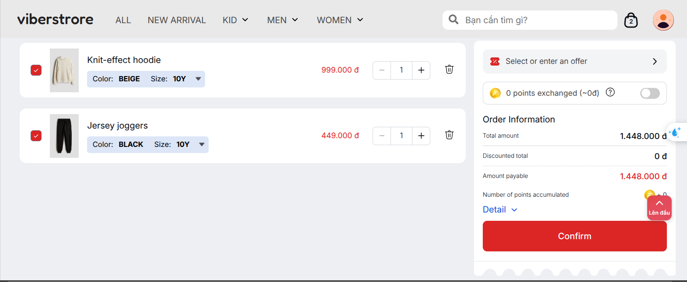

# ViberStore



ViberStore là ứng dụng thương mại điện tử thời trang, gồm giao diện mua sắm cho khách hàng, trang quản trị và REST API. Hệ thống sử dụng React, Django REST Framework, MySQL, Redis và Nginx; các dịch vụ được đóng gói bằng Docker Compose.

## Chức năng

### Dành cho khách hàng

- Xem danh sách sản phẩm, bộ sưu tập và tìm kiếm sản phẩm.
- Xem thông tin chi tiết, phân loại và biến thể sản phẩm.
- Đăng ký, đăng nhập và khôi phục mật khẩu.
- Quản lý giỏ hàng và địa chỉ giao hàng.
- Đặt hàng, chọn phương thức thanh toán và thanh toán qua VNPay.
- Theo dõi đơn hàng, xem lịch sử và gửi yêu cầu hủy đơn.
- Đánh giá sản phẩm.

### Dành cho quản trị viên

- Quản lý sản phẩm, danh mục và nhà cung cấp.
- Quản lý đơn hàng và thông tin khách hàng.
- Quản lý chương trình khuyến mãi và mã giảm giá.
- Đăng nhập vào trang quản trị riêng.

## Công nghệ và cấu trúc

- `frontend/`: React app cho khách hàng.
- `admin/`: React app quản trị.
- `backend/`: Django REST API, chia theo các miền sản phẩm, người dùng, giỏ hàng, đơn hàng, thanh toán, khuyến mãi, đánh giá và địa chỉ.
- MySQL 8: cơ sở dữ liệu chính, khởi tạo từ `initial_data/` khi tạo volume lần đầu.
- Redis: dịch vụ cache/broker.
- Nginx: điểm truy cập HTTP và reverse proxy cho các ứng dụng.

Các đường dẫn chính qua Nginx:

| Đường dẫn | Ứng dụng |
| --- | --- |
| `/` | Cửa hàng trực tuyến |
| `/dashboard/` | Trang quản trị React |
| `/admin/` | Django admin |
| `/api/` | REST API |
| `/media/` | Ảnh và tệp tải lên |
| `/django-static/` | Tệp static của Django |

## Triển khai

### Yêu cầu

- Docker Engine
- Docker Compose plugin (`docker compose`)
- Tệp `.env` ở thư mục gốc dự án

Tạo và cấu hình `.env` với các biến phù hợp môi trường, gồm `APP_HOST`, `APP_SCHEME`, `DJANGO_SECRET_KEY`, `DJANGO_DEBUG`, các biến `MYSQL_*`, `EMAIL_*`, `VNPAY_*`, `ADMIN_EMAIL` và `ADMIN_PASSWORD`. Không commit thông tin bí mật hoặc `.env` dùng cho production.

Frontend và trang quản trị dùng API cùng origin qua Nginx, với base path `/api/v1`.

### Development

Stack development mount mã nguồn backend để tiện chỉnh sửa. Từ thư mục gốc dự án, chạy:

```bash
docker compose -f deploy/docker-compose.dev.yml up -d --build
```

Mở ứng dụng tại `http://localhost:8080`. MySQL được expose ở host port `3310`; backend và Redis chỉ truy cập qua mạng Docker.

Xem trạng thái và log:

```bash
docker compose -f deploy/docker-compose.dev.yml ps
docker compose -f deploy/docker-compose.dev.yml logs -f
```

### Production

Điền secret mạnh và domain/IP thật vào `.env`, sau đó chạy từ thư mục gốc:

```bash
docker compose -f deploy/docker-compose.prod.yml up -d --build
```

Nginx nhận kết nối HTTP tại port `80`. Truy cập cửa hàng ở `http://your-domain-or-ip/`, trang quản trị tại `http://your-domain-or-ip/dashboard/`, API tại `http://your-domain-or-ip/api/v1/` và Django admin tại `http://your-domain-or-ip/admin/`. Compose production hiện cũng map MySQL ra host ở port `3309`; Redis chỉ truy cập qua mạng Docker nội bộ.

Swagger UI có tại `http://your-domain-or-ip/api/v1/swagger/schema`.

### Khởi chạy bằng script ở thư mục gốc

Repo cũng có stack Compose ở `docker-compose.yml`. Script sau kiểm tra `.env`, chuẩn bị thư mục cần thiết, validate cấu hình và khởi động stack đó:

```bash
./setup.sh
```

Script hỗ trợ `--install-docker` để cài Docker Engine và Compose plugin trên Ubuntu nếu máy chưa có. Stack này dùng port `80` cho Nginx và `3309` cho MySQL.

## Dữ liệu và tài khoản quản trị

MySQL chạy các script trong `initial_data/` khi volume dữ liệu được tạo lần đầu. Khi volume đã tồn tại, việc khởi động lại container không nạp lại dữ liệu bootstrap. Xóa volume sẽ xóa dữ liệu MySQL/Redis đã lưu, vì vậy hãy sao lưu trước khi thực hiện thao tác đó.

Khi backend khởi động, `entrypoint.sh` gọi lệnh `create_admin`. Tài khoản được tạo từ `ADMIN_EMAIL` và `ADMIN_PASSWORD` trong `.env` nếu chưa tồn tại.

## Cấu hình thanh toán

VNPay được cấu hình qua các biến `VNPAY_*` trong `.env`, gồm URL thanh toán, mã terminal, khóa bí mật và URL trả về. Mặc định URL trả về được tạo từ `APP_SCHEME` và `APP_HOST`, trừ khi bạn cấu hình riêng `VNPAY_RETURN_URL`.

## Ghi chú

- Backend hiện chạy bằng Django `runserver` theo `backend/entrypoint.sh`; cấu hình này phù hợp môi trường phát triển và kiểm thử.
- Repo có cả SQL bootstrap trong `initial_data/` và Django migrations. Trước khi thao tác schema, cần xác định schema hiện có được quản lý theo hướng nào để tránh chạy lặp thay đổi.
- `backend/media/` chứa tệp tải lên; `backend/static/` là đầu ra của `collectstatic`.
